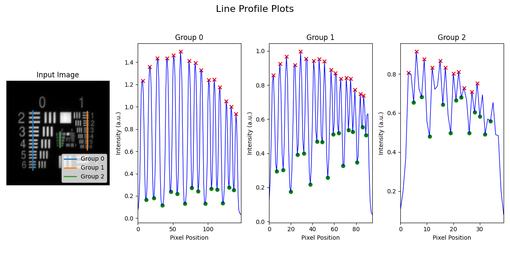
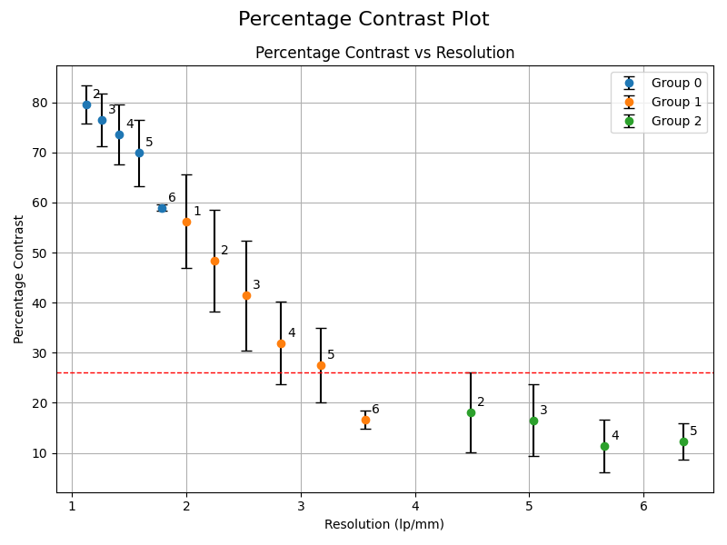
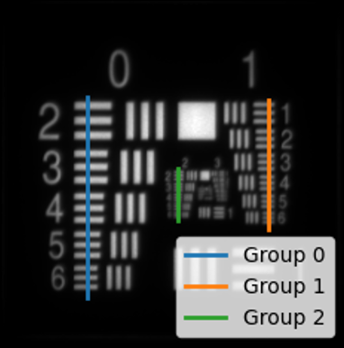
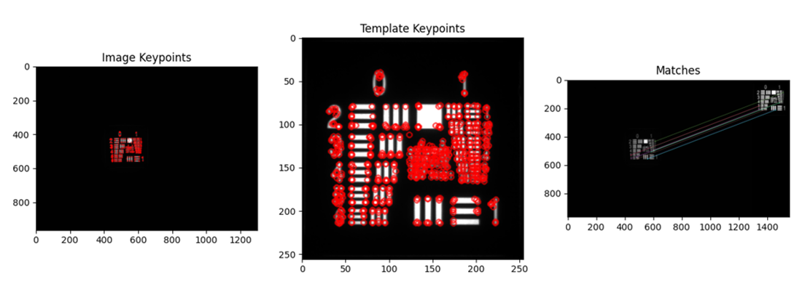

# Reference Resolution Target Analysis
This document details analysis methods for QUEL Imaging's reference resolution (RRT) target using the qal library. At a high level, the document is structured into four sections: a brief description of the target, followed by a "quick start" section showing basic use of the code, then a more detailed overview of how the code works, and finally, the example.

<br/>

# Target Description
The RRT target consists of a negative 1951 USAF resolution test chart with a fluorescent backing. It allows assessing the fluorescence resolution capability of an imaging system. See the use guide (available here: https://shop.quelimaging.com/resources/) for more information on the target, including imaging recommendations.

An image of the RRT can be analyzed to provide a plot of contrast versus spatial resolution. Contrast is defined as:

$$ Contrast (\\%) = {{{I_{max} - I_{min}} \over {I_{max} + I_{min}}} * 100} $$

where $I_{max}$ is the maximum intensity along a line profile crossing a set of bars on the target (e.g. Group 0, Element 2), and $I_{min}$ is the minimum intensity along the line profile.

<br/>

# Quick Start
The runnable script is `qal/examples/resolution_rrt/resolution_gui_example.py`. The matching notebook is `qal/examples/jupyter-notebook/resolution_rrt_gui_example.ipynb`.

```bash
python -m qal.examples.resolution_rrt.resolution_gui_example
```

That script loads an image, optionally straightens the chart for clicking, opens one selection window, measures contrast on the original pixels, and plots the results. The same series of functions is:

```python
from qal import RrtAnalyzer, RrtDataPlotter, RrtLineSelection, RrtROI, select_rrt_lines
from qal.data import res_sample_1

image = res_sample_1()
crop = RrtROI().crop_resolution_target(image)
gui_image = crop.image if crop is not None else image

selection = select_rrt_lines(gui_image, crop=crop, mode="manual_live_preview")
if isinstance(selection, RrtLineSelection):
    if crop is not None:
        selection = crop.selection_to_source(selection)
    contrast = RrtAnalyzer().load_and_process_groups(image, selection.group_coordinates)
    RrtROI.print_smallest_resolved(contrast, 26)
    plotter = RrtDataPlotter()
    plotter.plot_line_profiles(image, selection.group_coordinates, contrast)
    plotter.plot_percentage_contrast(contrast)
```

`select_rrt_lines` is the only line-placement window. Pick one mode:

- `automatic_refinement`: click two registration corners; they snap onto the chart and the standard three lines are derived.
- `manual_live_preview`: drag two registration crosshairs; the profiles update as you drag.
- `manual_line_profiles`: draw each measurement line. `line_count` is 1 to 6.
- `manual_coordinates`: no window. Pass `registration_points` or `line_coordinates` from a previous run.

Passing `registration_points` or `line_coordinates` skips the window in every mode. A confirmed selection can be saved as `selection.yaml` and reused on later images.

The line-profile figure and the contrast figure look like this:

<p align="center">

</p>

<p align="center">

</p>

<br/>

# Methodology
Analysis of the RRT target consists of three steps. These are:
* ROI selection
* Contrast calculation
* Visualization of results

<br/>

## Step 1 - ROI selection
ROI selection for the RRT target involves taking line profiles along the horizontally-oriented bars of the target, as shown in the image below. A limitation of this method is that it only assesses resolution in the axis perpendicular to the bars, and an imaging system could have different resolution horizontally versus vertically (if that is the case, consider taking a second image of the RRT target rotated by 90°).
<p align="center">

</p>

`RrtROI.crop_resolution_target()` aligns the chart to an internal USAF 1951 reference and returns a crop plus the mapping back to the original image. Click on the crop, then call `crop.selection_to_source()` so the profiles are sampled from the original pixels. Keyword arguments are forwarded to `get_resolution_target_cropped()`.

<table>
<tr>
<td width="25%" align="right" valign="top">
im_src
</td>
<td width="75%">
<i>Required</i>. A 2D array containing an image of the RRT target.
</td>
</tr>
<tr>
<td width="25%" align="right" valign="top">
show_kp
</td>
<td width="75%">
<i>Optional</i>. Whether to display the keypoints used in pattern matching. If <code>True</code>, a figure is displayed showing the identified keypoints in the input image, the keypoints from the reference image, and the matching between the two. Default is <code>False</code>.
</td>
</tr>
<tr>
<td width="25%" align="right" valign="top">
min_good_matches
</td>
<td width="75%">
<i>Optional</i>. The minimum number of matches acceptable for detecting the RRT target in an input image. It is recommended to not change this parameter. Default is <code>10</code>.
</td>
</tr>
<tr>
<td width="25%" align="right" valign="top">
min_kp_dist_threshold
</td>
<td width="75%">
<i>Optional</i>. A distance threshold for use in identifying good matches in pattern matching. Values closer to 0 filter more matches. It is recommended to not change this parameter. Default is <code>0.45</code>.
</td>
</tr>
<tr>
<td width="25%" align="right" valign="top">
save_cropped_im
</td>
<td width="75%">
<i>Optional</i>. If provided, the path (with or without an extension) to save the cropped resolution target image. The image is saved as a TIFF file if no extension is specified. Default is <code>None</code>, meaning the image is not saved.
</td>
</tr>
</table>

If the crop fails, set `show_kp=True` on `get_resolution_target_cropped()` and check that the chart is being matched:

```python
rrt_roi = RrtROI()
debug = rrt_roi.get_resolution_target_cropped(image, show_kp=True, return_debug=True)
```

This will produce a figure like the one below:
<p align="center">

</p>

`select_rrt_lines()` then places the profiles. Registration modes ask for two corners: the top-left of the top bar of Group 0 Element 2, and the bottom-right of the bottom bar of Group 0 Element 1. From those corners the standard three lines are Group 0 elements 2–6, Group 1 elements 1–6, and Group 2 elements 2–6. `manual_line_profiles` can add later groups, up to Group 5. Line `i` always measures Group `i`.

On the desktop the call blocks until Enter and returns an `RrtLineSelection`, or `None` if the window is closed first. A Jupyter widget backend returns an `RrtSelectionSession`; after Confirm, read `session.result`.

To repeat a placement without the window, pass coordinates printed by a previous run:

```python
selection = select_rrt_lines(
    gui_image,
    mode="manual_coordinates",
    registration_points=[(54.9, 76.6), (202.8, 215.4)],
)
```

or pass explicit line endpoints:

```python
selection = select_rrt_lines(
    gui_image,
    mode="manual_coordinates",
    line_coordinates=[
        ((63.5, 71.7), (63.5, 220.0)),
        ((198.7, 74.2), (198.7, 169.3)),
        ((131.4, 125.2), (131.4, 164.0)),
    ],
)
```

`selection.group_coordinates` is the dictionary consumed by contrast calculation. Each entry has the form `group: {"coordinates": ((x1, y1), (x2, y2)), "elements": range(...)}`.

<br/>

## Step 2 - Contrast calculation
In this step, contrast is calculated using line profiles provided. Contrast is calculated as:

$$ Contrast (\\%) = {{{I_{peak} - I_{trough}} \over {I_{peak} + I_{trough}}} * 100} $$

where $I_{peak}$ is the intensity of a peak along the line profile, and $I_{trough}$ is the intensity of a trough along the line profile. The `load_and_process_groups()` method of the `RrtAnalyzer` class calculates contrast for the line profiles provided. It requires two inputs, the original image of the RRT target, and the line profiles in that image's coordinates. Say the input image is named `image`, and `group_coordinates` contains information on the line profiles, obtain contrast using:
```python
analyzer = RrtAnalyzer()
percentage_contrast_df = analyzer.load_and_process_groups(image, group_coordinates)
```
The output will be a dataframe that looks like the following:
```
    Group  Element  Resolution (lp/mm)  Line Width (microns)  Percentage Contrast  Percentage Contrast Std     Peak Indices   Trough Indices
0       0        2            1.122462                445.45            87.053581                 1.584939      [8, 19, 30]     [13, 24, 36]
1       0        3            1.259921                396.85            85.991051                 1.954597     [43, 52, 63]     [48, 58, 68]
2       0        4            1.414214                353.55            84.327156                 2.218656     [75, 83, 92]     [79, 88, 97]
3       0        5            1.587401                314.98            82.977661                 3.235596  [103, 110, 118]  [107, 114, 123]
4       0        6            1.781797                280.62            79.815170                 0.529114  [128, 134, 141]       [131, 138]
5       1        1            2.000000                250.00            81.593788                 3.607717      [5, 11, 17]      [8, 14, 21]
6       1        2            2.244924                222.72            80.453758                 3.791615     [25, 30, 36]     [27, 33, 39]
7       1        3            2.519842                198.43            76.364128                 6.128937     [42, 47, 52]     [45, 50, 55]
8       1        4            2.828427                176.78            70.688057                 7.896383     [58, 62, 67]     [60, 65, 69]
9       1        5            3.174802                157.49            71.349907                 6.221506     [72, 76, 80]     [74, 78, 82]
10      1        6            3.563595                140.31            54.038887                 3.870470     [85, 88, 91]         [86, 90]
11      2        2            4.489848                111.36            37.544437                 8.677942       [4, 7, 10]       [6, 8, 11]
12      2        3            5.039684                 99.21            30.408937                 9.227140     [13, 15, 18]     [14, 17, 20]  
13      2        4            5.656854                 88.39            29.949408                 5.480946     [21, 23, 29]     [22, 24, 28]
14      2        5            6.349604                 78.75            24.296225                 9.130061     [31, 33, 37]     [30, 32, 34] 
15      2        6            7.127190                 70.15                  NaN                      NaN               []         [36, 38]
```
A common thing to look for is where the contrast reaches 26.4%, which determines the resolution limit of the imaging system based on the Rayleigh criterion. In the example data above, this is before Group 2, Element 5. Hence, the smallest resolvable feature is Group 2, Element 4, which has a resolution of 5.657 lp/mm. `RrtROI.print_smallest_resolved(contrast, threshold)` prints that feature.

<br/>

## Step 3 - Visualization
Final visualization is done using the `RrtDataPlotter` class. This class has two methods for plotting. The first, `plot_line_profiles()`, displays the input image of the RRT target, overlaid with the line profiles used in analysis, as well as the intensity data from each of the line profiles. Inputs to the method are defined below:
<table>
<tr>
<td width="25%" align="right" valign="top">
im
</td>
<td width="75%">
<i>Required</i>. A 2D array containing the input image of the RRT target.
</td>
</tr>
<tr>
<td width="25%" align="right" valign="top">
group_coordinates
</td>
<td width="75%">
<i>Required</i>. A dictionary containing information about the line profiles analyzed. This should be the same as the dictionary used in Step 2.
</td>
</tr>
<tr>
<td width="25%" align="right" valign="top">
percentage_contrast_df
</td>
<td width="75%">
<i>Required</i>. A dataframe containing analysis results. This is the output of the <code>load_and_process_groups()</code> method of <code>RrtAnalyzer</code>.
</td>
</tr>
</table>

Assuming the variable `image` is the original image of the RRT target, `group_coordinates` is a dictionary containing line profile information, and `percentage_contrast_df` is a dataframe containing analysis results, visualize the line profiles using:
```python
visualizer = RrtDataPlotter()
visualizer.plot_line_profiles(image, group_coordinates, percentage_contrast_df)
```
The second visualization method, `plot_percentage_contrast()`, plots the calculated contrast as a function of spatial resolution (in lp/mm). Its inputs are defined below:
<table>
<tr>
<td width="25%" align="right" valign="top">
df
</td>
<td width="75%">
<i>Required</i>. A dataframe containing analysis results. This is the output of the <code>load_and_process_groups()</code> method of <code>RrtAnalyzer</code>.
</td>
</tr>
<tr>
<td width="25%" align="right" valign="top">
resolution_threshold
</td>
<td width="75%">
<i>Optional</i>. The y-axis value for a horizontal dashed red line drawn on the plot to help indicate the resolution limit. Default is <code>26</code>, based on the Rayleigh criterion.
</td>
</tr>
</table>

Example use:
```python
visualizer = RrtDataPlotter()
visualizer.plot_percentage_contrast(percentage_contrast_df)
```
<br/>

# Example
The script is `qal/examples/resolution_rrt/resolution_gui_example.py`. Edit the settings at the top (`IMAGE_PATH`, `SAVE_RESULTS`, `MODE`, `AUTO_CROP`, `LINE_COUNT`, and optional coordinates), then run:

```bash
python -m qal.examples.resolution_rrt.resolution_gui_example
```

With `IMAGE_PATH` unset, the script uses `res_sample_1()`. With `SAVE_RESULTS` on, plots, a CSV, and `selection.yaml` are written next to the image, or next to the script in `res_sample_1_results/` when using the built-in example. The notebook `qal/examples/jupyter-notebook/resolution_rrt_gui_example.ipynb` runs the same functions one cell at a time.
